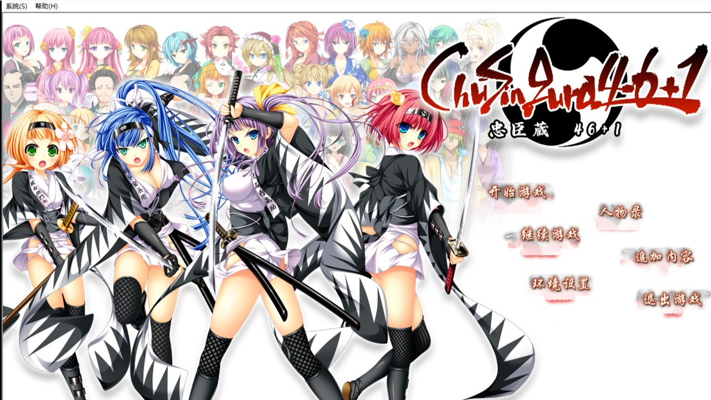

# 忠臣蔵46+1（ChuSinGura46+1）PC 版 简体中文汉化补丁

《ChuSinGura46+1 -忠臣蔵46+1-》PC 版的完整简体中文汉化补丁。
覆盖**全部剧情章节**（主线五路线 + 讨入动画章节 + 后日谈）、全部系统界面
（标题菜单 / 环境设置 / 人物录 / 存档读档 / 追加内容 / 鉴赏），共 496 个补丁文件。

> 📌 **本补丁适用于 PC 原版（KiriKiri 引擎，光盘版 / DL 版均可）** —— 下载后放入游戏目录即可生效。
>
> 🎮 Steam 版（ChuSinGura46+1 S，Unity 重制版）玩家请看 [steam-s/](steam-s/) —— 对应补丁在同一 [下载页](https://github.com/LujiaJin/ChuSinGura46Plus1-Chinese-Patch/releases/latest)。

> ⭐ **如果这个补丁帮到了你，欢迎点个 Star 支持作者** —— 你的 Star 能让更多玩家看到它。

## 下载安装

到 [**下载页**](https://github.com/LujiaJin/ChuSinGura46Plus1-Chinese-Patch/releases/latest) 下载 **`ChuSinGura46Plus1_PC_ZH_Patch.zip`**（约 22.6 MB，全量汉化，一站式的最终版）。

1. 完全退出游戏
2. 解压，将 `patch.xp3` 复制到游戏安装目录（与 `bgimage.xp3`、`scenario.xp3` 同一文件夹）
3. 启动游戏 —— 全部内容即为简体中文

卸载：删除 `patch.xp3` 即恢复日文原版，存档不受影响。

## 补丁覆盖范围

| 模块 | 内容 |
|---|---|
| 剧情全文 | C / E / I / Y / S 全部分支路线 + 序章 + 本篇讨入 + 讨入动画章节（douga 15 文件）+ 后日谈（omake）|
| 系统界面 | 标题菜单、警告页、环境设置、人物录、存档 / 读档、追加内容、CG / 场景 / 影像 / 音乐鉴赏、全部弹窗 |
| 人物录 | 列表页 + **43 张角色详情页**（名字 / 职位 / 俸禄 / 人物介绍全中文，家徽与底纹保留）|
| 语音设置 | 33 名角色音量名牌 + 页头副标题 + 图例 |
| 章节选择 | 六张章节底图（五章节毛笔字条带）+ 章节横幅说明 |
| 影像鉴赏 | 开场 / 结尾动画按钮 9 张（三态重绘）|
| 角色名 | 49 个角色宏 + 25 个旁白说话人 + 人物录 43 人全名 |
| 字体 | 全局统一微软雅黑，杜绝缺字回退造成的字形混杂 |
| 按钮图 | 菱形菜单按钮、消息窗快捷按钮、鉴赏入口卡片、对话框是/否等全部重绘 |

## 已知事项

- 「追加内容 → 片头动画」播放结束后可能无响应 —— **日文原版同样存在**（引擎视频组件缺陷，与补丁无关）；重启游戏即可，或改用「影像鉴赏」入口观看
- 替换补丁前请**完全退出游戏进程**（引擎启动时锁定补丁文件）
- 部分内容需通关解锁（游戏进度机制）

## Steam 版（ChuSinGura46+1 S）补丁

Steam 重制版（Unity 引擎）有独立补丁，支持游戏内三语言切换（简体中文 / English / 日本語），带自动安装器。
详见 [steam-s/](steam-s/) 目录说明。

## 声明

- 本补丁的安装器程序与构建工具 **Copyright © 2026 Jin Lujia**，汉化译文版权归汉化作者所有。
- 本补丁仅供学习交流，**需持有正版游戏**。游戏及全部素材版权归
  [Inre](https://store.steampowered.com/app/464780/) 所有。
- 请勿将本补丁用于商业用途或与游戏本体捆绑分发。
- 译文语料与游戏原始文本不在本仓库中公开分发。

## 反馈

遇到问题或想反馈译文，请到 [Issues](../../issues) 留言。
觉得好用的话，欢迎给仓库点个 ⭐ Star 支持作者，也欢迎分享给身边的玩家。
